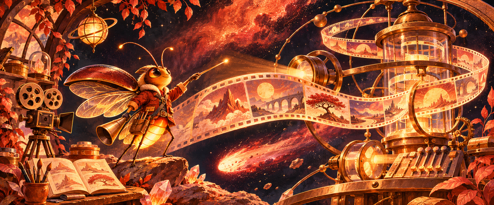
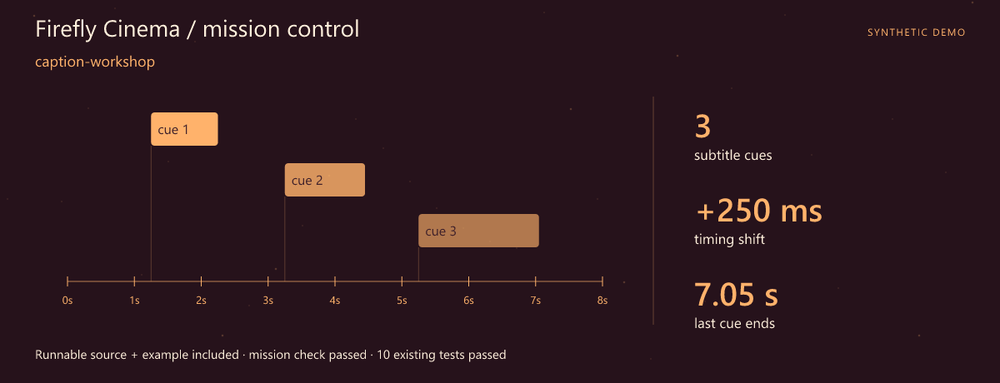
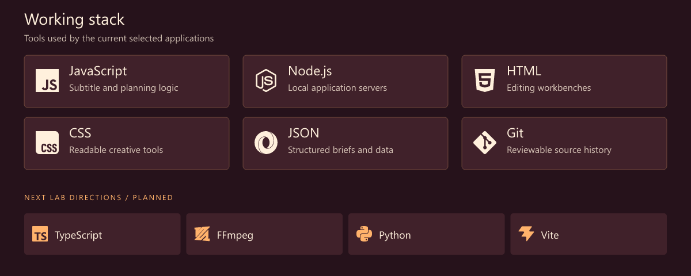
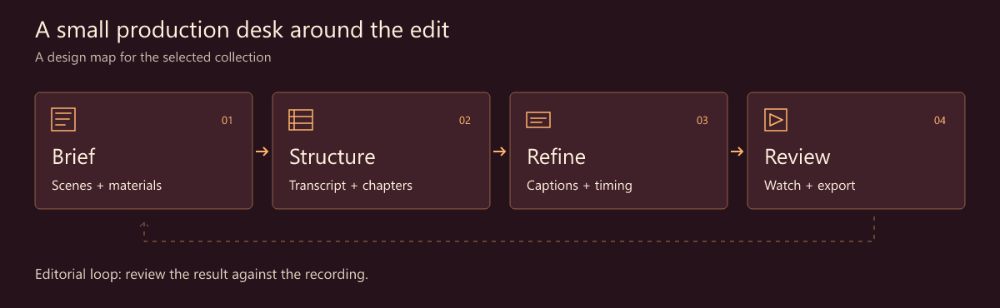
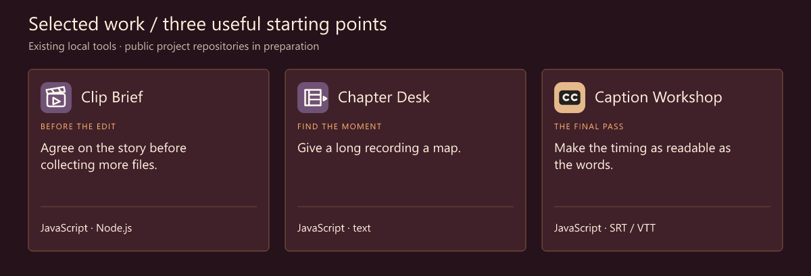

# Mao Mao · Creative Tools Developer · JavaScript

> **Firefly Cinema** · A little light around the edit.

**Give the story a clearer path through the tools.**

[Download the runnable mission](src/assets/launch.zip) · [Launch guide](src/LAUNCH.md) · [Working stack](#working-stack) · [Selected work](#selected-work)

## Mission control



**First launch: caption-workshop.** A complete source snapshot, synthetic example and assertion script are included. The mission check and **10 existing tests** passed. [Try the mission](src/LAUNCH.md) · [Snapshot and checked result](src/assets/launch.json).

I'm Mao Mao. My focus is software around the edit: a brief that makes the materials clear, chapters that help someone find a moment again, subtitles that deserve a careful final pass.

Creative work has plenty of small, precise tasks. A focused utility can keep those tasks visible while leaving room for editorial judgment.

## What I focus on

- **Subtitle tools.** SRT/VTT editing, timing adjustments and an export worth reviewing.
- **Story structure.** Scenes, materials and chapter markers give a long recording a visible shape.
- **Interfaces around the timeline.** Keep the task small enough to understand and the source close enough to check.

## Working stack



The upper panel shows technologies used by the selected tools. The lower row is the next lab track.

## How I think about the work



## Selected work

Three existing local tools form this curated collection. Their public project repositories are being prepared.



| Project / stack | Why it belongs here | Input → output |
| --- | --- | --- |
| **Clip Brief**<br>JavaScript · Node.js | Agree on the story before collecting more files. Structure a video brief with scenes, timing and a list of required materials. | **In:** Brief + scene entries<br>**Out:** A structured production plan |
| **Chapter Desk**<br>JavaScript · text | Give a long recording a map. Prepare chapter markers from an annotated transcript. | **In:** Annotated transcript<br>**Out:** Chapter markers |
| **Caption Workshop**<br>JavaScript · SRT / VTT | Make the timing as readable as the words. Edit plain SRT/VTT cues, apply literal replacements or a millisecond shift, then export. | **In:** SRT or VTT subtitles<br>**Out:** Reviewed SRT/VTT exports |

### A tiny scene on the subtitle desk

```srt
1
00:00:01,200 --> 00:00:03,800
A small detail changes the rhythm.
```

Synthetic subtitle text. The next useful action is to inspect the cue, adjust it if needed and review it against a recording.

## Code and activity


These charts are rebuilt on a six-hour schedule after GitHub Pages is enabled. The observation time is printed on every chart. Commits are unique default-branch SHAs across all authors and owned public repositories, including forks. Language bytes describe repositories, not personal skill. Public interactions are a limited event feed (up to 300 events / 30 days), not visitor analytics. API and image caches may delay updates.

[Live data and scope](https://ma9911.github.io/ma9911/src/assets/live/metrics.json) · [Portfolio website](https://ma9911.github.io/ma9911/) · [Refresh setup](src/SETUP.md)

## Next lab

1. **A clearer scene plan.** Make materials and missing shots easier to inspect.
2. **A better chapter pass.** Refine titles and the path back to a transcript moment.
3. **A comfortable subtitle review.** Explore richer timing feedback and a typed editor boundary.

## Start a conversation

A subtitle edge case, a hard-to-navigate transcript or a brief that needs a clearer structure is welcome as a concrete example.

[Open the profile repository's issues](https://github.com/ma9911/ma9911/issues) · [Browse the repositories](https://github.com/ma9911?tab=repositories)

> 🎬 Between the captions and the final cut.

---

<sub>Fictional developer persona · AI-illustrated avatar. Curated tools retain original authors, licenses and commit history. Technology icons: Simple Icons.</sub>

[Artwork and data notes](src/assets/NOTICE.md)
